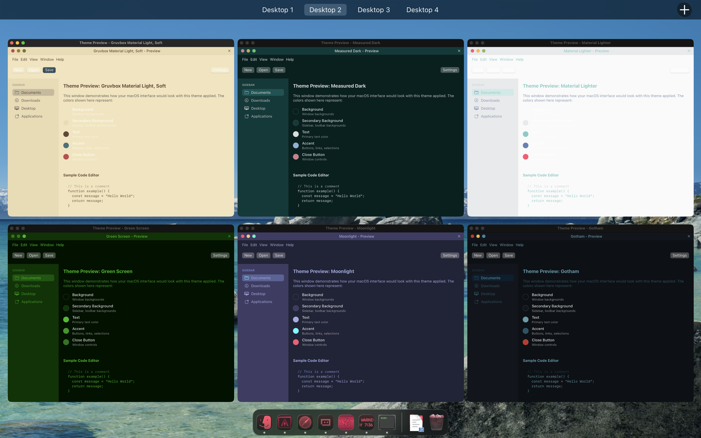
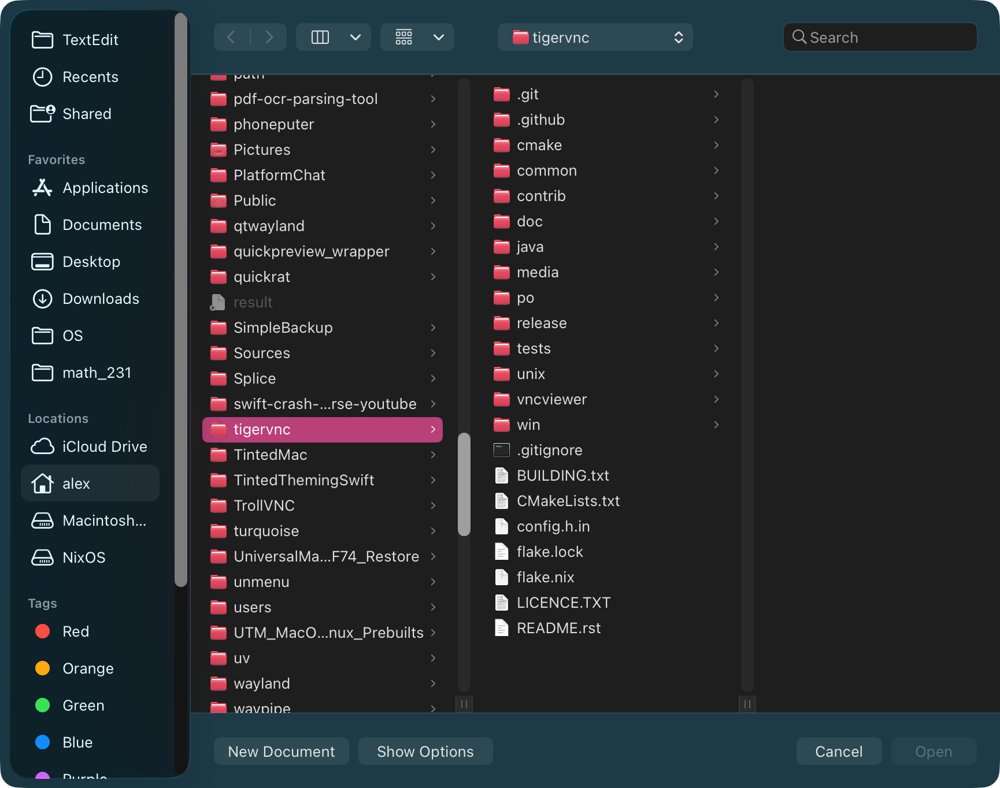
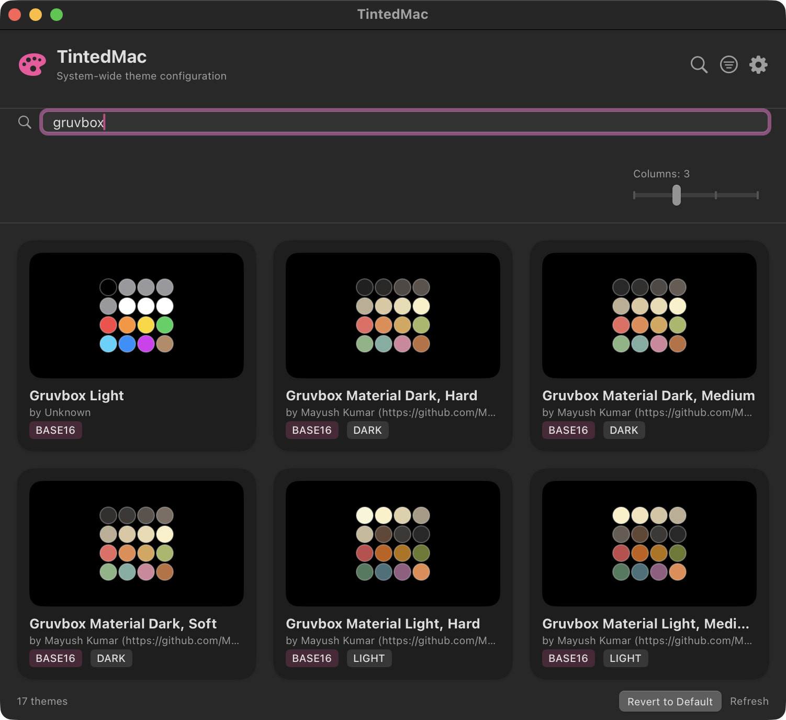
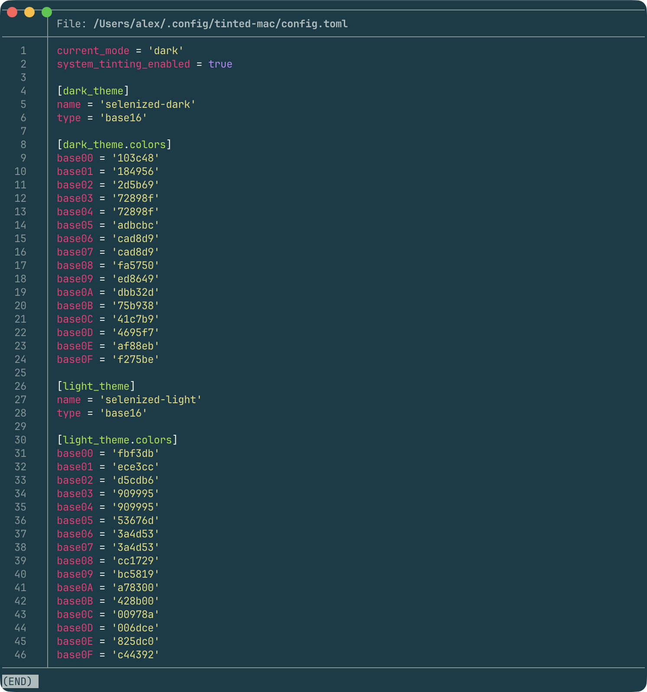

# TintedMac

Apply base16 color schemes to customize the appearance of your macOS windows.

<sup>*Note: This is a custom macOS tweak that requires disabling System Integrity Protection (SIP) to function properly.*</sup>

## Preview

|  |  |
| --------------------------------- | --------------------------------- |
|  |  |

## Features

- Apply customizable color tints to any macOS window
- Standalone TintedMac application for easy configuration
- More than 290 built-in color schemes with customizable configuration options
- Blacklist support for excluding specific applications and processes

## Usage

Configuration is stored in `~/.config/tinted-mac/config.toml`

You can modify settings using a text editor such as nvim, or utilize the TintedMac GUI configurator to choose between light and dark theme variants.

Deploy TintedMacInject to `/var/ammonia/core/tweaks/TintedMac.dylib`
Deploy TintedMacInject's blacklist to `/var/ammonia/core/tweaks/TintedMac.dylib.blacklist`

Place TintedMacHelper in `/usr/local/bin`.
Set up the TintedMacHelper Launch Agent in `~/Library/LaunchAgents`.

## Building

This project uses a Makefile for build automation and contains the following targets:

- **TintedMac**: Main GUI theme customizer application
- **TintedMacInject**: SIMBL-compatible dynamic library for system-wide injection
- **TintedMacHelper**: Helper utility for privileged operations

### Build Instructions

Use the provided Makefile for all build operations:

```bash
# Build all targets
make build

# Build individual targets
make tintedmac        # Build TintedMac GUI application
make tintedmacinject  # Build TintedMacInject dynamic library
make tintedmachelper  # Build TintedMacHelper utility

# Run the TintedMac GUI application
make run

# Install tweak and helper to system
make install

# Uninstall everything from system
make uninstall

# Show all available targets
make help
```

### Package Creation

```bash
# Build the project first, then:
./package.sh
```

This creates `tintedmac.pkg` which can be distributed and installed on other systems.

## System Requirements

**Note**: System Integrity Protection (SIP) must be disabled for TintedMac to function properly.

**Required**: [Ammonia](https://github.com/CoreBedtime/ammonia) must be installed for TintedMac to work. Ammonia provides the SIMBL-compatible injection framework that TintedMac relies on.

## Configuration

### Blacklist Applications

Edit `TintedMacInject.dylib.blacklist` to exclude specific applications:

```
# Add bundle identifiers of apps to exclude
com.apple.finder
com.example.myapp
Alacritty
Finder
...
```

## Project Structure

<details>
<summary>Project Structure</summary>

```
TintedMac/
├── TintedMac/                                    # Main GUI application
│   ├── AppDelegate.swift                         # Application delegate
│   ├── AppearanceManager.swift                   # Appearance management
│   ├── ColorEditorView.swift                     # Color picker interface
│   ├── Config.swift                              # Configuration management
│   ├── CustomBase24Loader.swift                  # Theme loading utilities
│   ├── main.swift                                # Application entry point
│   ├── SettingsView.swift                        # Settings interface
│   ├── ThemeBrowserView.swift                    # Theme browser
│   ├── ThemeCustomizeView.swift                  # Theme customization
│   ├── ThemeManager.swift                        # Theme management logic
│   ├── ThemePreviewWindow.swift                  # Preview functionality
│   ├── TintManager.swift                         # Core tinting logic
│   └── ViewController.swift                      # Main window controller
├── TintedMacInject/                              # SIMBL injection library
│   └── TintedMacInject.swift                     # Injection implementation
├── TintedMacHelper/                              # Helper utility
│   ├── main.swift
│   └── TintedMacProtocol.swift
├── Shared/                                       # Shared components
│   ├── TintedMacConstructor/                     # Constructor utilities
│   │   ├── constructor.c
│   │   └── include/
│   └── WindowAdditions/                          # NSWindow extensions
│       ├── WindowAdditions.mm                    # Objective-C++ implementation
│       └── include/
├── Resources/                                    # Configuration files and assets
│   ├── com.aspauldingcode.TintedMac.helper.plist # LaunchAgent configuration
│   └── TintedMacInject.dylib.blacklist ``````````# Application blacklist
├── Makefile                                      # Build automation (primary build system)
├── package.sh                                    # Package creation script
└── Preview*.png                                  # Screenshot previews
```

</details>

## Contributing

Contributions are welcome! Please feel free to submit pull requests or open issues for bugs and feature requests.

## License

This project is licensed under the MIT License - see the [LICENSE](LICENSE) file for details.

## Author

Made by Alex Spaulding (aspauldingcode)

*✨ Built with love for the macOS tweaking community ✨*
